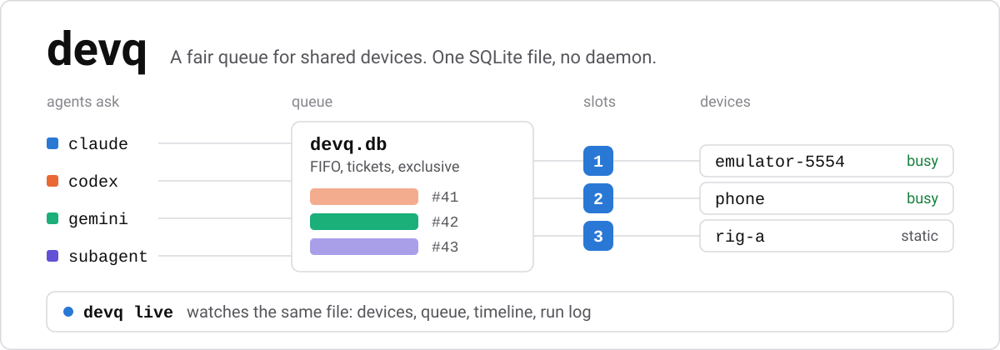
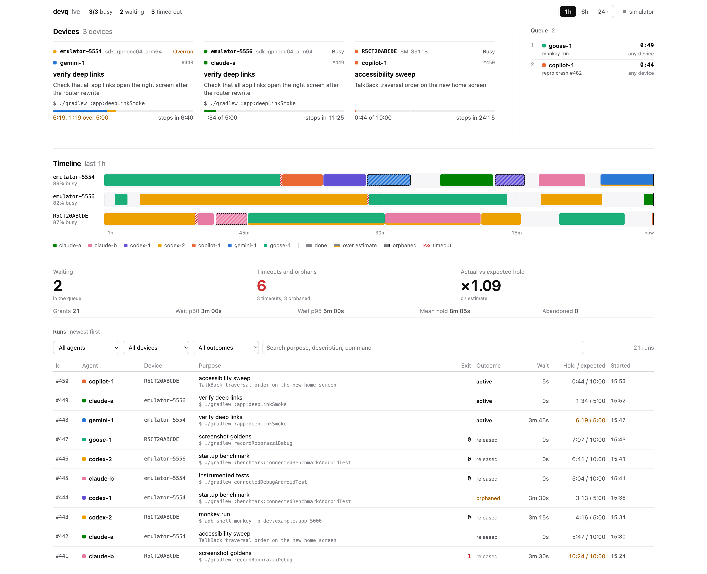

<h1 align="center">devq</h1>

<p align="center">
  <a href="https://github.com/mikepenz/agent-device-orchestrator/actions/workflows/ci.yml"></a>
  <a href="LICENSE"></a>
  <a href="https://www.rust-lang.org/"></a>
  
</p>

<p align="center">
  <picture>
    <source media="(prefers-color-scheme: dark)" srcset="art/hero-dark.svg">
    
  </picture>
</p>

<p align="center">
  <a href="#quickstart">Quickstart</a> &bull;
  <a href="#showcase">Showcase</a> &bull;
  <a href="#reference">Reference</a>
</p>

| | |
|---|---|
| **No daemon** | Every `devq` process coordinates through one SQLite file in `~/.devq`. The database is the coordinator. |
| **Fair FIFO queue** | Requests get tickets and are served in order. A pinned request never blocks the ones behind it. |
| **`devq run`** | Wraps any command, holds the device lock for its lifetime, and kills the whole child process group on `--max`. |
| **Live dashboard** | `devq live` serves a local page with devices, queue, timeline and run log. Install it as a PWA or run it as a Mac service. |
| **Agent skill** | `devq skills add` teaches Claude Code (and other agent tools) to take a slot before touching a device. |
| **Optional hook** | `devq hook install` blocks raw `adb` calls that have no slot. A guardrail, not a sandbox. |

## Quickstart

1. Install.

   ```sh
   cargo install --git https://github.com/mikepenz/agent-device-orchestrator --locked
   ```

2. Teach your agents to use it.

   ```sh
   devq skills add
   ```

3. Run something on a device, then watch it.

   ```sh
   devq run --agent me --purpose "read model" -- adb shell getprop ro.product.model
   devq live --open
   ```

## Showcase

The dashboard in its simulator mode (`?mock=1`), regenerated by `scripts/readme-art/screenshots.sh`. Sections shown: **Devices**, **Queue**, **Timeline**, stat strip, **Runs**.

<p align="center">
  <picture>
    <source media="(prefers-color-scheme: dark)" srcset="art/dashboard-dark.png">
    
  </picture>
</p>

-------

# Reference

| Topic | |
|---|---|
| [Install](#install) | From source or git |
| [Quick start](#quick-start) | Everyday commands |
| [Commands](#commands) | Flags and subcommands |
| [What agents need to know](#what-agents-need-to-know) | Exit codes, `--max`, tickets, orphans |
| [Config](#config) | `[pool]` in `config.toml` |
| [Live dashboard](#live-dashboard) | Server, API, SQL |
| [Run it as a Mac app](#run-it-as-a-mac-app) | `devq service`, PWA |
| [Agent instructions](#agent-instructions) | Snippet for CLAUDE.md / AGENTS.md |
| [Skill for agents](#skill-for-agents) | `devq skills` |
| [Enforcement hook](#enforcement-hook) | `devq hook` |
| [Platforms](#platforms) | macOS, Linux, Windows |
| [How it works](#how-it-works) | Design and contract |
| [Development](#development) | Tests and art scripts |

`devq` is a single-machine orchestrator that lets several AI agents share a limited set of devices (Android emulators and phones, plus generic "static" resources) through a fair FIFO queue. It has no daemon. Every `devq` process coordinates through one SQLite file in `~/.devq` (override with `DEVQ_HOME`).

## Install

Prebuilt archives for macOS, Linux and Windows are on the [releases page](https://github.com/mikepenz/agent-device-orchestrator/releases) (with `CHECKSUMS-SHA256.txt`). Or build it:

```sh
cargo install --git https://github.com/mikepenz/agent-device-orchestrator --locked
# or, from a checkout:
cargo install --path .
```

## Quick start

```sh
devq devices                      # what the pool contains
devq run --agent me --purpose "instrumented tests" -- ./gradlew connectedDebugAndroidTest
devq request --agent me --purpose "manual poking"   # prints "<slot> <serial>", e.g. "2 emulator-5554"
devq release 2                                      # give the slot back
devq live --open                  # dashboard in the browser
```

## Commands

Slot flags (`request` and `run`):

| Flag | Default | Meaning |
|---|---|---|
| `--agent <AGENT>` | env `DEVQ_AGENT` | Required (except with `--ticket`). Who is asking. |
| `--purpose <PURPOSE>` | none | Required (except with `--ticket`). Why. |
| `--description <DESCRIPTION>` | `""` | What the work does. |
| `--expect <EXPECT>` | `10m` | Expected hold time. |
| `--max <MAX>` | `30m` | Hard limit. Must be >= `--expect`, between 1s and 1 year. |
| `--device <DEVICE>` | any | Pin to one serial. |

Durations: `90s`, `10m`, `1h30m`, `2d` (units ms, s, m, h, d, w).

| Command | Options | What it does |
|---|---|---|
| `devq request` | slot flags (`--agent`/`--purpose` optional with `--ticket`), `--wait <WAIT>`, `--ticket <TICKET>`, `--json` | Queue for a device and block until granted. Prints `<slot> <serial>`, or `{"slot":id,"device":serial}` with `--json`. |
| `devq release <ID>` | none | Release an active slot or cancel a waiting one. |
| `devq run -- <CMD>...` | slot flags | Acquire, run the command, release. Exits with the command's exit code. |
| `devq status` | `--json` | Devices, holders and queue. |
| `devq devices` | `--json` | Pool contents (serial, kind, state, model). |
| `devq live` | `--port <PORT>` (default `7878`), `--open` | Web dashboard. |
| `devq service` | `install [--port]`, `restart`, `uninstall`, `status` | Run `devq live` as a macOS launchd service. |
| `devq skills` | `list`, `add`, `update`, `remove` | Install and manage the bundled agent skill. |
| `devq hook` | `install`, `uninstall`, `test <COMMAND>`, `--strict` | Optional guardrail against raw adb. |

## What agents need to know

- **Exit codes.** `0` granted (for `run`, the command's own code). `75` means `--wait` expired. `request` prints `ticket <id>`, and you must re-run with `--ticket <id>` within about 30s to keep your queue position. `2` is bad arguments. `1` is an unknown or already finished slot (`release`) or another error. `run` also returns 127 if the command cannot start, 124 if `--max` killed a command that otherwise exited 0, and 128+signal for a signalled child.
- **Environment for the child.** `devq run` sets `ANDROID_SERIAL`, `DEVQ_DEVICE` and `DEVQ_SLOT`.
- **`--max` is enforced.** `devq run` sends SIGTERM to the command's process group, then SIGKILL 5s later. The slot ends with reason `timeout`. A slot taken with `request` has no child, so it is simply ended as `timeout` once `--max` passes, by whichever `devq` process polls next.
- **Background processes die with the command.** The command runs in its own process group. When the leader exits, `devq` sends SIGTERM and then SIGKILL to the rest of the group before it frees the device.
- **Orphan detection.** `devq run` records its pid. If `devq` is killed (for example `kill -9`), the next `devq` process that polls notices the dead pid, kills the command's process group and ends the slot as `orphaned`. This covers waiting `run` slots too. Slots from `request` have no pid, so only `--max` frees them.
- **Waiters must keep polling.** Polling is what keeps a ticket alive. A ticket not polled for 8s is skipped when devices are handed out, and one not polled for 30s is ended as `abandoned`.
- **The lock is advisory.** Nothing stops a process from running `adb` against a device it does not hold. Always target `$ANDROID_SERIAL` (`adb -s "$ANDROID_SERIAL" ...`), never "whatever is attached".
- **No stdin.** The child's stdin is `/dev/null`. Ctrl-C and SIGTERM sent to `devq` are forwarded to the child's group. While still waiting in the queue they cancel the slot (exit 130 or 143).

## Config

`$DEVQ_HOME/config.toml`, optional. Globs support `*`.

```toml
[pool]
include = ["emulator-*"]    # empty means everything adb reports
exclude = ["emulator-5556"]
static  = ["rig-a"]         # non-adb resources, always online
```

Unknown keys or a malformed file are an error. The file is re-read on every command.

## Live dashboard

`devq live` serves on 127.0.0.1 only and returns 403 unless the `Host` header is `127.0.0.1:<port>` or `localhost:<port>` (DNS rebinding guard). `GET /` is the page. `GET /api/state?window=<secs>` returns JSON (default 3600, clamped to 1..604800).

The page shows Devices, Queue, Timeline (1h, 6h, 24h), a stat strip, the Runs log, and Per device and Per agent tables. Append `?mock=1` to force the built-in simulator. Blocked hook attempts also appear in `/api/state`.

The database is plain SQLite, so you can analyse it directly. Hold time per agent:

```sh
sqlite3 ~/.devq/devq.db "SELECT agent, COUNT(*) AS grants, SUM(released_at - granted_at) / 1000.0 AS held_s
  FROM slots WHERE released_at IS NOT NULL AND granted_at IS NOT NULL GROUP BY agent ORDER BY held_s DESC"
```

Columns of `slots` include `state`, `end_reason` (`released`, `timeout`, `orphaned`, `cancelled`, `abandoned`), `command`, `exit_code`; times are unix milliseconds.

## Run it as a Mac app

```sh
cargo install --path .      # a stable binary path for launchd
devq service install        # LaunchAgent: starts at login, restarts on crash (--port, default 7878)
```

Then open http://127.0.0.1:7878/ and install the page: Chrome menu -> "Install devq live", or Safari -> File -> Add to Dock. `devq service status` shows launchd state; run `devq service restart` after upgrading the binary; `devq service uninstall` removes it. Logs go to `~/.devq/live.log`. macOS only; elsewhere run `devq live` under systemd --user or similar.

## Agent instructions

Paste into CLAUDE.md or AGENTS.md.

```markdown
## Devices (devq)
- Never touch an emulator or phone without a devq slot. Devices are shared with other agents.
- Wrap device work: `devq run --agent <name> --purpose "<why>" --description "<what>" --expect <d> --max <d> -- <cmd>`
- Inside the command, use `$ANDROID_SERIAL` (`adb -s "$ANDROID_SERIAL" ...`). Never rely on the default device.
- Interactive sessions: `devq request --agent <name> --purpose "<why>" --wait 25s`. Exit 75 prints `ticket <id>`.
  Resume at once with `devq request --ticket <id> --wait 25s` (no `--agent`/`--purpose` needed), and repeat until it exits 0.
- A granted request prints `<slot> <serial>`. Use that serial, and always run `devq release <slot>` when done.
- Set `--expect` to a realistic duration and `--max` to the longest you can tolerate. `--max` kills the command.
- `devq status` shows who holds what. `devq live --open` shows the dashboard.
```

## Skill for agents

The skill teaches Claude Code agents to use `devq` correctly. It ships inside the binary, so the installed copy always matches the CLI version.

```sh
devq skills add              # global: ~/.claude/skills/devq/SKILL.md
devq skills add --project    # this project: ./.claude/skills/devq/SKILL.md
devq skills add --dir <path> # other agent tools: <path>/devq/SKILL.md
devq skills list             # not installed / installed / outdated / modified locally
devq skills update           # refresh outdated copies (modified ones are skipped)
devq skills remove           # delete an unmodified copy (--force for edited ones)
```

`add` and `remove` refuse to touch a hand-edited or foreign `SKILL.md` unless you pass `--force`. The source is [`.claude/skills/devq/SKILL.md`](.claude/skills/devq/SKILL.md).

## Enforcement hook

A skill is advisory, and terse prompts ("install the debug apk") often skip it. The optional hook blocks raw device commands that have no slot and tells the agent how to use `devq`.

```sh
devq hook install                       # global, Claude Code (--project, --dir <PATH>, --target claude|codex|gemini)
devq hook install --deny-rules          # claude only: also add static permissions.deny backstop rules
devq hook install --strict              # internal errors block instead of passing
devq hook test "adb shell getprop"      # prints allow or deny (+ reason) without reading stdin
devq hook uninstall                     # removes exactly what install added
```

- Install is idempotent and keeps every other key in the settings file. It targets `.claude/settings.json`, `~/.codex/hooks.json` or Gemini `settings.json`.
- The hook reads the PreToolUse/BeforeTool JSON on stdin. Exit 2 means blocked, and the stderr text is shown to the model. All three agent CLIs treat it that way.
- It flags `adb` calls (except `adb devices`, `adb version`, `adb help`), `am instrument`, `gradlew ... connected*Test` and `emulator -avd`, including inside `sh -c`, pipes, `sudo` and similar wrappers.
- It allows a command that runs under `devq run ... --`, or an adb call targeting a serial (`-s <serial>` or `ANDROID_SERIAL=<serial>`) that has an active slot. Per-agent slots are enforced when `DEVQ_AGENT` is set.
- On internal errors it fails open by default; `--strict` fails closed. Each block is recorded and shown on the dashboard. About 17 ms per call.
- **Guardrail, not a sandbox.** Known gaps: scripts or `python -c` that call adb internally, `$(which adb)` and `$ADB`, gradle task abbreviations such as `cAT`, and any slot counts when `DEVQ_AGENT` is unset.
- **Codex:** hooks need to be trusted once through its `/hooks` UI; `install` prints a note.
- **Gemini:** the Codex and Gemini formats are unverified against a live CLI.

## Platforms

- **macOS** is the primary, fully tested platform.
- **Linux** is tested in a Linux container without a device (`scripts/linux-container.sh` via Apple `container`, plus CI on ubuntu: build, tests, `scripts/smoke-linux.sh`). `devq service` is macOS-only; on Linux run `devq live` from a systemd user unit (`ExecStart=%h/.cargo/bin/devq live`, `Restart=on-failure`).
- **Windows** is compile-checked with the gnu target (`cargo check --target x86_64-pc-windows-gnu`); the MSVC toolchain and the runtime are untested. The `.sh` test scripts need WSL or Git Bash. Known limitations: commands are force-killed with no grace period, there is no SIGTERM handling, grandchildren of an exited leader are not killed, and pid reuse is not detected.

## How it works

- The coordinator is a SQLite file (`$DEVQ_HOME/devq.db`, WAL mode). A tick under the database lock reaps timeouts, orphaned pids and abandoned waiters, then hands free devices to the oldest compatible request.
- `devq live` is the same binary serving an embedded page; there is no separate daemon.
- Contracts and phase history: [`docs/TASKS.md`](docs/TASKS.md). Dashboard tokens, layout and motion rules: [`design/NOTES.md`](design/NOTES.md).

## Development

```sh
cargo test
scripts/e2e.sh        # needs a running emulator (emulator-5554)
scripts/e2e-live.sh   # same, plus the live server
scripts/linux-container.sh  # Linux build, tests and smoke test (Apple `container`)
```

### Supply chain

Every dependency is pinned and gated in CI (`.github/workflows/ci.yml`):

- Direct dependencies are exact pins (`=x.y.z`), checked by `scripts/check-exact-pins.sh`; `Cargo.lock` pins the rest and every build runs `--locked`.
- No crate version younger than 7 days: `scripts/check-dependency-age.sh` (diff mode on PRs, `--all` weekly). Renovate bumps pins after the same cooldown.
- `cargo deny check`: crates.io only, permissive licenses only, RustSec advisories, no wildcards (`deny.toml`). `cargo audit` runs as well.
- The Rust toolchain is pinned in `rust-toolchain.toml`, every GitHub Action is pinned to a commit SHA, and gitleaks scans for secrets.

```sh
scripts/check-exact-pins.sh && scripts/check-dependency-age.sh --all && cargo deny check && cargo audit
```

The art in `art/` is generated, not hand-captured:

```sh
python3 scripts/readme-art/hero.py        # art/hero-light.svg, art/hero-dark.svg
scripts/readme-art/screenshots.sh         # art/dashboard-*.png (needs Chrome; CHROME=... to override)
```

\* Windows is compile-checked only, see [Platforms](#platforms).
